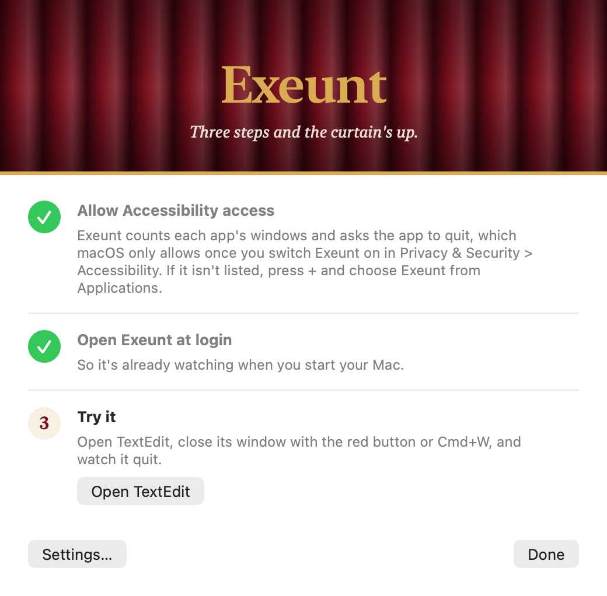
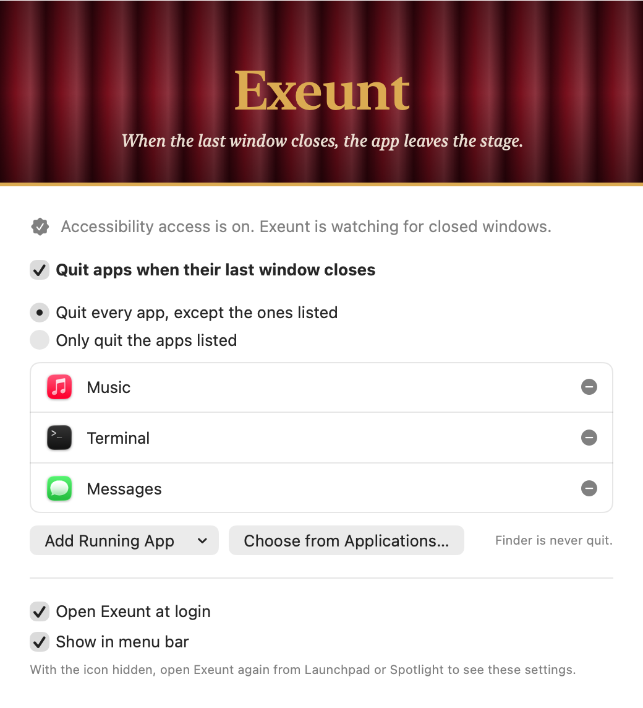

<p align="center"></p>

# Exeunt

A tiny Mac menu bar app that quits an app when you close its last window. Red cross, Cmd+W or File > Close: once the
last window's gone, so is the app. Like Windows, basically.

I used RedQuits for years, but it's Intel-only, and Rosetta's on its
way out after macOS 27. Swift Quit was the obvious replacement, except it waits for a "window closed" signal that
macOS 26 doesn't send any more, so it just sits there. So I wrote my own. Exeunt doesn't wait for that signal: it counts
an app's windows just before you click or press Cmd+W, counts them again just after, and if there were some and now
there are none, it quits the app.

<p align="center"> </p>

## Install

1. Grab `Exeunt-1.1.0.dmg` from [Releases](https://github.com/Gentatsu/exeunt/releases/latest). It's signed and
   notarised, so it opens without any right-click dance.
2. Drag Exeunt into Applications and open it.
3. It opens a little setup checklist: give it Accessibility access, leave it opening at login, then close a TextEdit
   window to see it work. Each step goes green as you do it. If something comes undone later (say you switch off the
   permission), the checklist pops back up. You can open it any time from the menu bar, or by opening Exeunt again.

It needs macOS 13 or later, and runs natively on Apple silicon and Intel.

## Why it needs Accessibility access

macOS only lets an app count another app's windows, and notice your clicks and Cmd+W, if you've switched it on under
System Settings > Privacy & Security > Accessibility. The setup checklist has a button that goes straight there. It doesn't
read what's in your windows, and it doesn't talk to the internet at all.

## Settings

Click the masks in the menu bar:

- **On/off**, for when you want apps to hang about.
- **Quit every app except these**, or flip it round and **only quit these**. Add apps from what's running or from
  Applications. Finder never gets quit, whatever you pick.
- **Open at login**, on by default.
- **Hide the menu bar icon.** Open Exeunt again from Launchpad or Spotlight to get back in.

## Languages

Exeunt's windows and menu come in English (British), Deutsch, Français, Español, Italiano, Português (Brasil), 日本語, 한국어, 简体中文, Nederlands, Polski and Türkçe, and follow your Mac's language.

<details><summary>In your language</summary>

**Deutsch:** Eine winzige Menüleisten-App für den Mac, die ein Programm beendet, sobald du sein letztes Fenster schließt. Wie unter Windows.

**Français:** Une minuscule app de barre des menus pour Mac qui quitte une app dès que vous fermez sa dernière fenêtre. Comme sous Windows.

**Español:** Una pequeña app de la barra de menús para Mac que cierra una app cuando cierras su última ventana. Como en Windows.

**Italiano:** Una piccola app per la barra dei menu del Mac che esce da un’app quando ne chiudi l’ultima finestra. Come su Windows.

**Português (Brasil):** Um pequeno app de barra de menus para Mac que fecha um app quando você fecha a última janela dele. Como no Windows.

**日本語:** 最後のウインドウを閉じるとAppも終了する、Mac用の小さなメニューバーAppです。Windowsと同じ感覚で使えます。

**한국어:** 마지막 윈도우를 닫으면 앱도 함께 종료해 주는 작은 Mac 메뉴 막대 앱입니다. Windows처럼 동작합니다.

**简体中文:** 一款小巧的 Mac 菜单栏 App：关闭某个 App 的最后一个窗口时，它会一并退出，就像在 Windows 上一样。

**Nederlands:** Een piepkleine Mac-menubalkapp die een app stopt zodra je het laatste venster sluit. Zoals op Windows.

**Polski:** Malutka aplikacja na pasek menu Maca, która zamyka aplikację, gdy zamkniesz jej ostatnie okno. Jak w Windowsie.

**Türkçe:** Bir uygulamanın son penceresini kapattığınızda uygulamadan çıkan, küçücük bir Mac menü çubuğu uygulaması. Tıpkı Windows’taki gibi.

</details>

## Build it yourself

You'll need Xcode 16 or later.

```sh
python3 tools/gen_xcodeproj.py   # writes Exeunt.xcodeproj
xcodebuild test -project Exeunt.xcodeproj -scheme Exeunt -destination 'platform=macOS'
open Exeunt.xcodeproj            # set your own team, then Run
```

`tools/release.sh` is how I make the signed, notarised DMG. It needs a Developer ID certificate in your keychain and
an App Store Connect API key in `ASC_KEY_PATH`, `ASC_KEY_ID` and `ASC_ISSUER_ID`.

## Licence

MIT. See [LICENSE](LICENSE).
